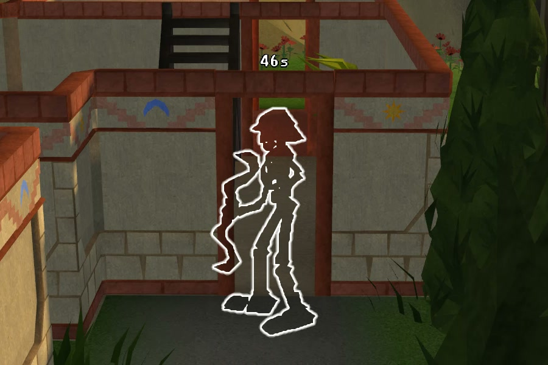

# Thrall In One

One plugin for everything to do with Arceuus thralls. Thrall In One brings together what's currently spread across several thrall plugins, and adds things none of them do.

It tells your thrall apart from everyone else's, so you can style each separately: hide every thrall, hide only other players', or give yours and theirs their own colors for each type. A crowded raid or boss room can lose the clutter while other players' thralls stay as a faint outline, so you still know they're there.

It has the reminders you'd expect: a recast prompt when your thrall runs out, and warnings when you're off the Arceuus spellbook or don't have your Book of the Dead, and a warning before you run out of runes. It can stop you recasting by accident, and it keeps track of how much your thralls do for you over time.

## Features

**Your thrall, and everyone else's**
- Outline yours, and hide or fade other players' thralls and their projectiles. Each has its own look, and an outline color for each type (Mage, Ranged, Melee).
- The outline follows the thrall's body only, without the square around its feet.
- Mute thralls' attack sounds (other players' only, or every thrall), and the sounds of thralls rising and returning to the grave.
- Covers every thrall, including the Leagues and Deadman variants.

**Timer**
- Seconds left shown above your thrall at the size you choose, turning orange as it runs out.
- Matches the game's duration, including the Master Combat Achievement bonus, and carries on if the plugin restarts while your thrall is out.

**Reminders**
- A Recast Thrall box when your thrall runs out mid-fight, and an optional notification for when you're tabbed out.
- An optional sound just before your thrall runs out (a bell, chime or ping, as loud as you like), and an optional screen flash.
- Warnings if you're off the Arceuus spellbook or don't have your Book of the Dead, only in fights while you're using thralls.
- In The Fractured Archive, a thrall left behind in another Ocellus quadrant or outside a boss arena counts as gone, so you're reminded to recast.
- Stays quiet in places thralls can't be summoned.

**Recast Guard**
- Dims the Resurrect spells while your thrall is out, and can ignore left-clicks on them, so you don't recast by accident.
- Lets the recast through a couple of seconds before your thrall runs out (Recast Window), or only once it's gone.

**Stats**
- Your thrall's uptime, its share of your damage, and its measured DPS next to the wiki's figure for its tier.
- What it costs you: prayer drained and the value of the runes actually used, so staves, tomes and combination runes count properly.
- Kept for the session, your lifetime, each thrall type and each raid, per account.

**Casts remaining**
- How many more thralls the runes you're carrying will pay for.
- A warning on screen and in the sidebar when you're running low or out, while you're on the Arceuus spellbook with your Book of the Dead.

**Sidebar panel**
- All of your stats in one place, opened from the plugin's sidebar button.
- A short What's New box after an update, which you can turn off (General > Show Update Notes).

## Using it with other plugins

Other plugins that hide, highlight or track thralls may not work well alongside this one.

## Changelog

- **1.3.0:**
  - TFA reminders: you're now reminded when your thrall gets left behind, or when you enter a boss room without one.
  - Recast Guard: dims the Resurrect spells while your thrall is out, and can block left-clicks on them, so you don't recast by accident.
  - Recast Sound and Recast Flash (Reminders): a sound just before your thrall runs out, and a screen flash when it's time to recast.
  - Casts Remaining now warns you when you're low on runes for thralls, or out of them.
  - The settings page is reworked to feel more organized.
  - A What's New box in the sidebar after updates (General > Show Update Notes).
- **1.2.1:** The Fractured Archive now counts as a raid. Big numbers in the sidebar are no longer cut off. A thrall left behind in another raid room now counts as gone, so the recast reminder shows.
- **1.2.0:** Mute thrall attack and summon sounds (Thralls > Mute Attacks, Mute Summon Sounds), and an Enabled tick for Timer, Reminders and Casts Left.
- **1.1.0:** Choose the timer's font size (Timer > Font Size).
- **1.0.0:** First release.

## Credits

- **Pet Pathing and Combat** by Mouker Joe
- **Thrall Highlighter** by Sung-Rai
- RuneLite's model outline renderer by Woox

## License

BSD 2-Clause. See [LICENSE](LICENSE).
