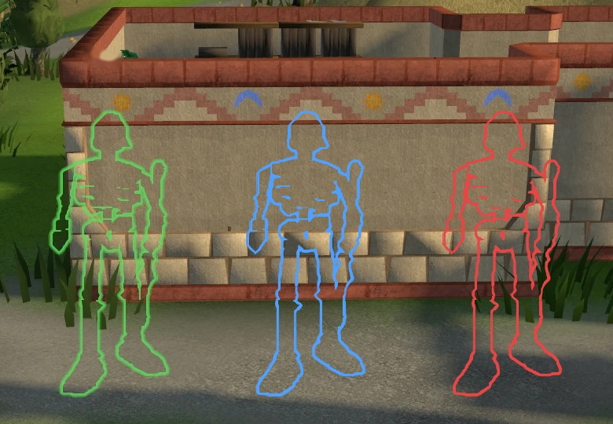

# Thrall In One

One plugin for everything to do with Arceuus thralls. Thrall In One brings together what's currently spread across several thrall plugins, and adds things none of them do.

It tells your thrall apart from everyone else's, so you can style each separately: hide every thrall, hide only other players', or give yours and theirs their own colors, by type if you like. A crowded raid or boss room can lose the clutter while other players' thralls stay as a faint outline, so you still know they're there.

It has the reminders you'd expect: a recast prompt when your thrall runs out, and warnings when you're off the Arceuus spellbook or don't have your Book of the Dead. It also keeps track of how much your thralls do for you over time.

## Features

**Your thrall, and everyone else's**
- Outline yours, and hide or fade other players' thralls and their projectiles. Each has its own look and color, or colors by type (Mage, Ranged, Melee).
- The outline follows the thrall's body only, without the square around its feet.
- Covers every thrall, including the Leagues and Deadman variants.

**Timer**
- Seconds left shown above your thrall at the size you choose, turning orange as it runs out.
- Matches the game's duration, including the Master Combat Achievement bonus, and carries on if the plugin restarts while your thrall is out.

**Reminders**
- A Recast Thrall box when your thrall runs out mid-fight, and an optional notification for when you're tabbed out.
- Warnings if you're off the Arceuus spellbook or don't have your Book of the Dead, only in fights while you're using thralls.
- Stays quiet in places thralls can't be summoned.

**Stats**
- Your thrall's uptime, its share of your damage, and its measured DPS next to the wiki's figure for its tier.
- What it costs you: prayer drained and the value of the runes actually used, so staves, tomes and combination runes count properly.
- Kept for the session, your lifetime, each thrall type and each raid, per account.

**Casts left**
- How many more thralls the runes you're carrying will pay for, with an optional warning when you're running low.

**Sidebar panel**
- All of your stats in one place, opened from the plugin's sidebar button.

## Using it with other plugins

Other plugins that hide, highlight or track thralls may not work well alongside this one.

## Changelog

- **1.1.0:** Choose the timer's font size (Timer > Font Size).
- **1.0.0:** First release.

## Credits

- **Pet Pathing and Combat** by Mouker Joe
- **Thrall Highlighter** by Sung-Rai
- RuneLite's model outline renderer by Woox

## License

BSD 2-Clause. See [LICENSE](LICENSE).
